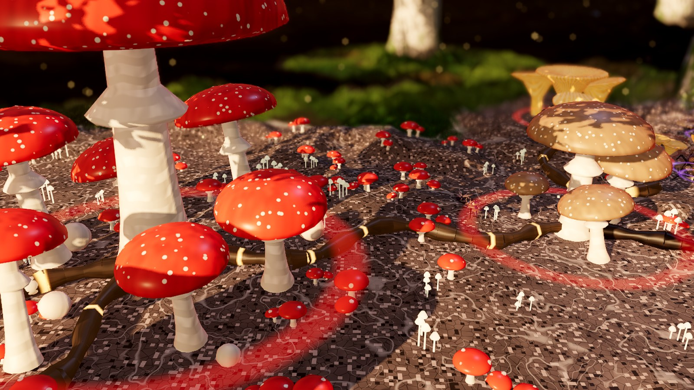
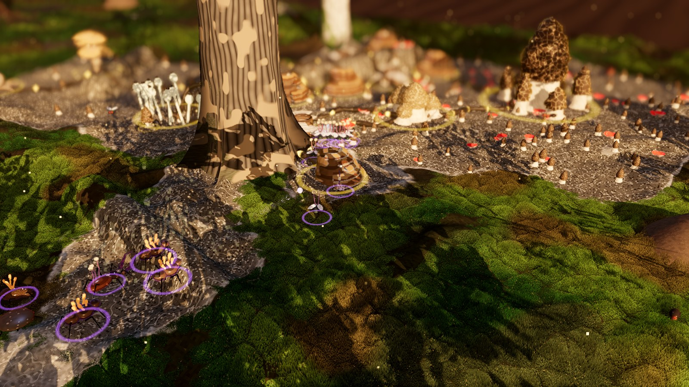
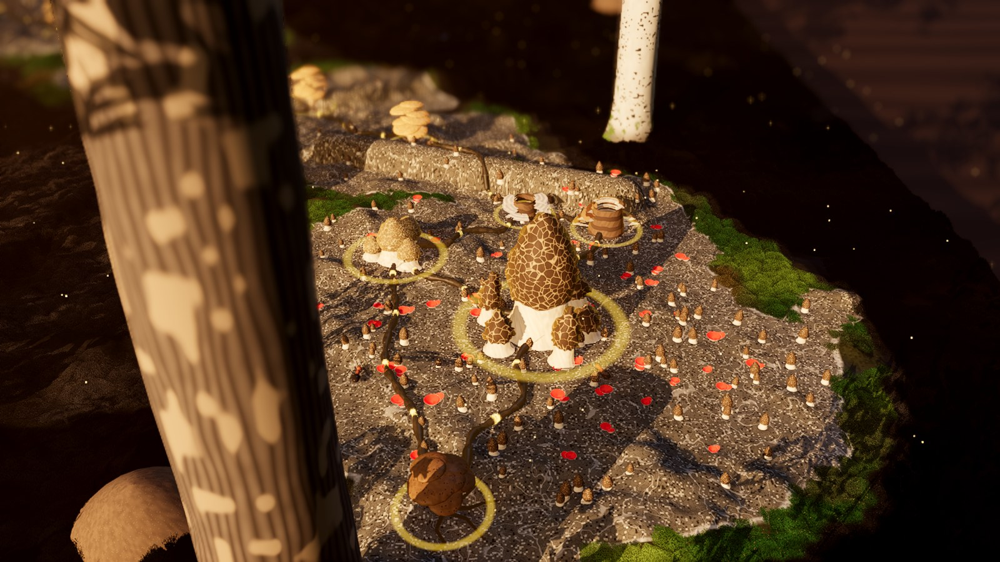
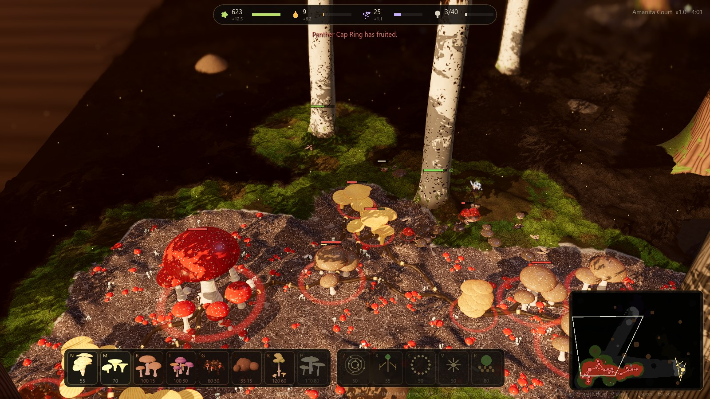

# RHIZOMORPH

A real-time strategy game on a forest floor. Three fungal courts fight over one patch of
woodland, and each one feeds in a different way, so each one wants a different forest.

- **Amanita Court** lives in partnership with the trees. It feeds them minerals and they pay it in sugar,
  so it needs the forest alive.
- **Morel Hollow** rots things. Logs, litter and corpses are its food, and Honey Rot turns a living tree
  into one more log. Its Coral Binder grows a spiked wall: select a Morel Patch, choose the Binder,
  click a root location on your mycelium, then click the wall endpoint.
- **Veiled Choir** is a parasite. It has no network to cut: it infects ants, beetles and flies and walks
  them to war as thralls.

The forest does not stand still. Trees sicken and fall, logs rot away, insects breed, and rain, drought,
windstorms and leaf fall change the board mid-match. A court's buildings are joined by glowing cords that
carry its income home, and cutting them starves whatever lies beyond.

## Build

- **Engine:** Godot 4.7.2 (Forward+, Vulkan), all GDScript.
- **Art:** fungal units and structures use procedural Blender builds with baked, painted atlases and
  shader motion; other forest elements are generated in code and shaders. Spreading mycelium is a GPU
  compute simulation, and the tree canopy exists only as the dappled shade it casts.
- **Audio:** music and sound effects generated with MusicGen and Stable Audio through ComfyUI
  (`tools/audio`), then reviewed by ear.
- **Balance:** a headless mode plays all-bot matches as fast as the CPU allows (`tools/sim/run_batch.py`).

To play, open the folder in Godot 4.7.2 and press Play, or run `godot --path .`.

Work in progress.
